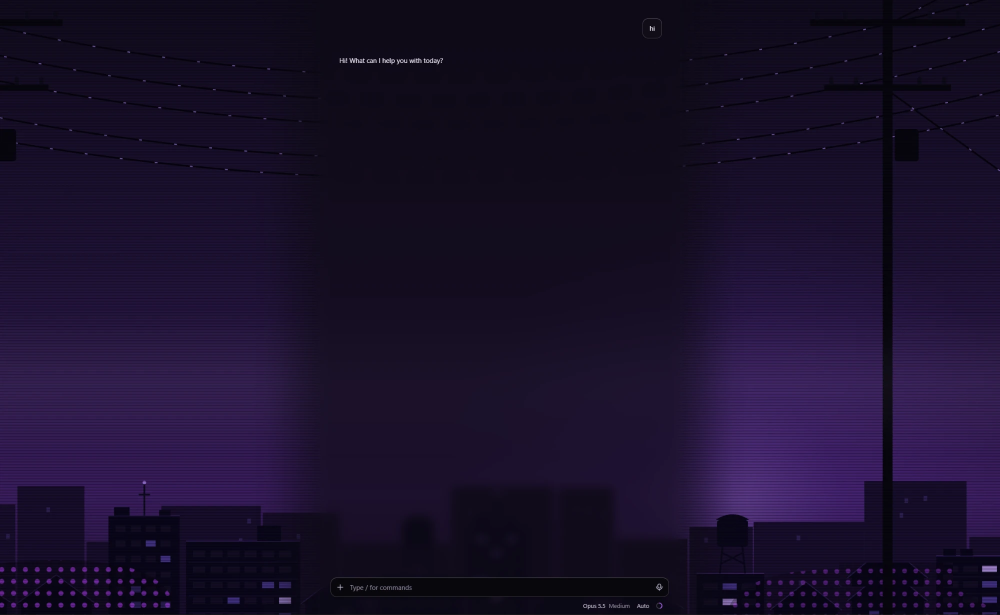
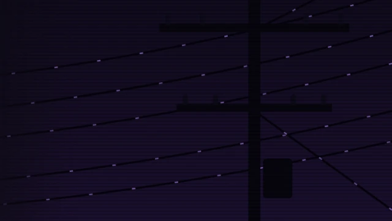
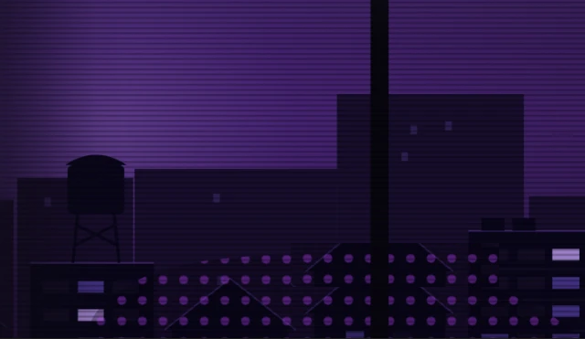

# Wired Dusk

A late-90s dusk theme for the Claude desktop app's Code tab. Power lines hum across a violet sky, apartment blocks glow on the horizon, and a faint CRT haze sits over everything, while the app itself turns near-black purple to match.



## The scene

The backdrop is live: this is the same drawing the theme puts behind the chat, playing here on its own.





- **Power lines** sag between two utility poles at the edges of the window. Small pulses of lavender light travel along each wire, as if signals are passing down the line.
- **The skyline** has two rows. A hazy far row of tall blocks with antennas stands behind a near row of apartment blocks with balconies, pitched-roof houses, a water tower on stilts and office blocks with a slowly pulsing light on the mast. Most windows are dark; a few glow.
- **Dusk glow** rises behind the rooftops on the right and slowly brightens and fades.
- **Dotted shadows** pool in the bottom corners and gently breathe.
- **CRT haze**: fine scanlines over the whole picture and a soft refresh bar that rolls down the screen.
- A small `serial experiments lain █` caption blinks in the top-right corner.



Nothing flickers or flashes. With your system set to reduce motion, the scene holds still.

## The colours

Dark mode only. The app's own surfaces take a violet tint so the chat sits naturally in the scene.

| Role | Colour |
| --- | --- |
| Page | `#0d0a13` |
| Cards and panels | `#14101b`, `#191421` |
| Text | `#ebe6f3` |
| Accent | `#9b62e0` (violet) |
| Success | `#5fbf6a` (phosphor green) |
| Warning | `#d79b2b` (amber) |
| Danger | `#e0455a` (red) |

## Install

In a terminal session, at the prompt:

```
/plugin install wired-dusk --marketplace zZero111/wired-dusk
```

Answer `y` to add the marketplace, then pick a scope (user is fine).

From a shell:

```
claude plugin install wired-dusk --marketplace zZero111/wired-dusk
```

In the desktop app, where `/plugin` does not run: click + next to the prompt box, then Plugins, Add marketplace with `zZero111/wired-dusk`, then Add plugin.

## Good to know

- The theme draws in **local** Code sessions in the desktop app, and in the mobile app when you open one. Cloud sessions run on Anthropic's servers and don't load it, and the terminal and editors don't draw themes.
- Chats that were already open when you installed it pick it up once the app has been fully quit and reopened.
- Tried on the Windows desktop app.

## Credits

`hooks/make-colors.js` is the colour helper that ships with Claude Code's plugin-authoring skill, copied in unchanged.

## License

[MIT](LICENSE)
